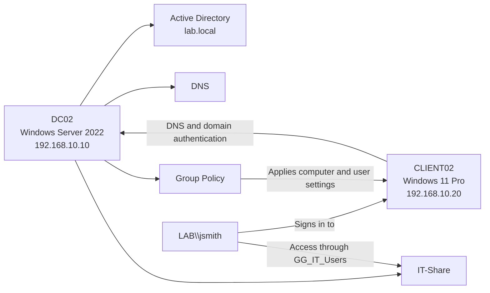
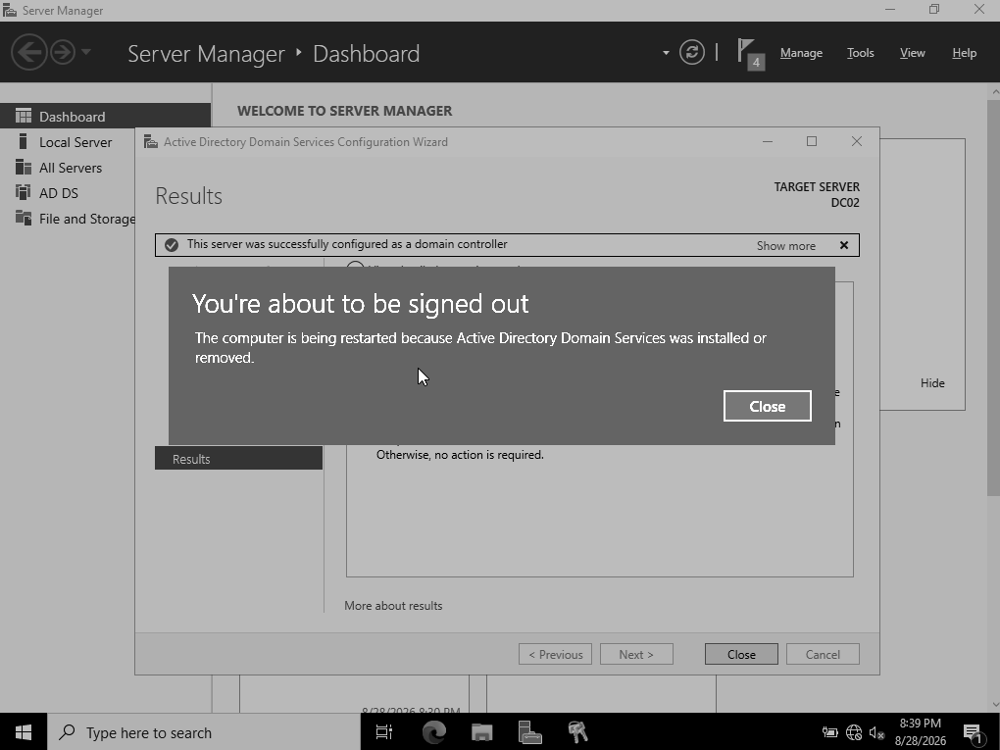
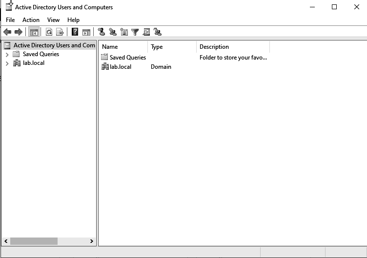
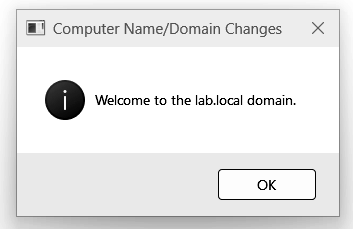
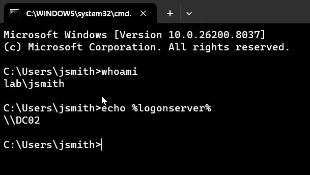
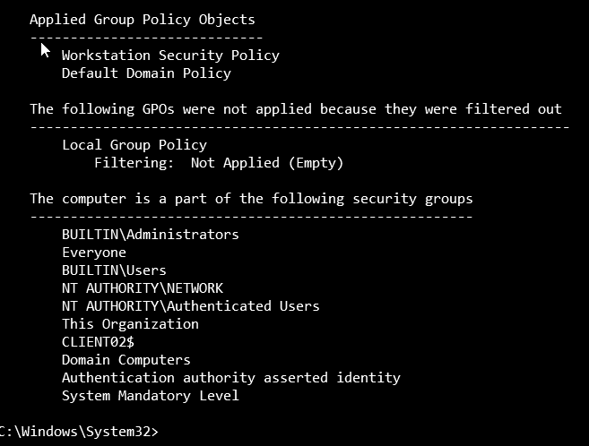
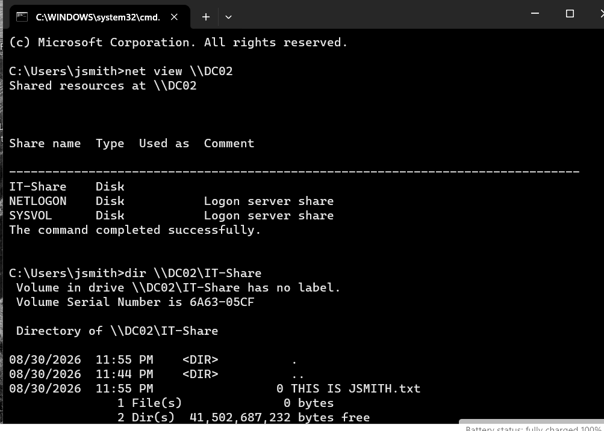

# Windows Server 2022 Active Directory Lab

An end-to-end virtual enterprise lab built with Oracle VirtualBox, Windows Server 2022, and Windows 11 Pro. The project demonstrates centralized identity, DNS, domain membership, Group Policy, role-based access, and secure SMB file sharing.

[Download the updated Active Directory portfolio](Windows_Server_2022_AD_Lab_Portfolio_Page_Numbers_Fixed.docx)

## Project summary

I deployed `DC02` as the domain controller and DNS server for `lab.local`, then connected the Windows 11 workstation `CLIENT02`. I created organizational units, a domain user, and the `GG_IT_Users` security group. I also applied workstation and user policies and configured an IT file share with separate share and NTFS permissions.

The documentation includes the successful configuration as well as troubleshooting evidence, such as an incorrect role selection, a client boot issue, a Group Policy command error, and a missing SMB share.

## Lab design



## Environment

| Component | Configuration |
|---|---|
| Hypervisor | Oracle VirtualBox |
| Server | `DC02` — Windows Server 2022 Standard Evaluation |
| Client | `CLIENT02` — Windows 11 Pro |
| Domain | `lab.local` |
| Server address | `192.168.10.10/24` |
| Client address | `192.168.10.20/24` |
| DNS | `192.168.10.10` |
| Test user | `LAB\jsmith` / John Smith |
| Security group | `GG_IT_Users` |
| File share | `\\DC02\IT-Share` |

## Implementation highlights

### 1. Domain controller deployment

Windows Server 2022 was installed on an isolated virtual machine. The server was renamed `DC02`, assigned a static address, and promoted as the first domain controller for the new `lab.local` forest.



### 2. Active Directory organization

The domain was organized with employee and workstation containers. A domain account for John Smith was created and later assigned to the IT security group.



### 3. Client domain membership

`CLIENT02` was configured to use the domain controller for DNS, tested for connectivity and name resolution, and joined successfully to `lab.local`.



### 4. Centralized authentication

The domain user signed in on `CLIENT02`. Command-line checks confirmed the `LAB\jsmith` identity and showed that authentication was handled by `DC02`.



### 5. Group Policy enforcement

One computer policy set a five-minute inactivity lock. A separate employee user policy blocked Control Panel and Windows Settings. `gpupdate` and `gpresult` confirmed that the policies were received and applied.



### 6. Role-based file access

The `IT-Share` SMB share was protected with layered permissions. `GG_IT_Users` received Change share permission and Modify NTFS permission, while Domain Admins retained Full Control. John Smith created and listed a test file to prove effective read/write access.



## Verification performed

```text
ipconfig /all
ping 192.168.10.10
nslookup lab.local
whoami
echo %logonserver%
gpupdate /force
gpresult /scope computer /r
gpresult /scope user /r
net view \\DC02
dir \\DC02\IT-Share
```

These checks verified addressing, DNS resolution, server reachability, domain identity, authenticating domain controller, computer and user GPO application, SMB publication, and file access.

## Skills demonstrated

- Virtual machine provisioning and isolated network configuration
- Windows Server and Windows client deployment
- Active Directory Domain Services and DNS administration
- Organizational units, users, computers, and security groups
- Domain joining and centralized authentication
- Group Policy creation, application, and troubleshooting
- SMB sharing and least-privilege NTFS permissions
- Command-line validation and evidence-based documentation

## Security and publishing notes

- Passwords are masked in the screenshots; no plaintext credentials, private keys, tokens, or product keys are included.
- The names, domain, and IPv4 addresses belong to an isolated demonstration lab and are included to make the project reproducible.
- The complete portfolio contains 180 grayscale screenshots. Only six representative images are kept separately here so the repository remains easy to browse.
- The Windows evaluation media itself is not included.

## Portfolio files

- `Windows_Server_2022_AD_Lab_Portfolio_BW.docx` — complete editable portfolio with 180 annotated screenshots
- `assets/` — selected grayscale evidence used by this README

## Lessons learned

The project reinforced that Active Directory depends on correct DNS configuration, and that effective file access is the intersection of share and NTFS permissions. It also showed the value of validating each layer separately: network reachability, name resolution, authentication, policy application, group membership, and resource authorization.

## Active Directory User Auditing with PowerShell

### Objective

Practice retrieving and verifying domain employee accounts using PowerShell and Active Directory.

### Environment

- Domain Controller: DC02
- Operating System: Windows Server 2022
- Domain: lab.local
- Organizational Unit: Employees → HR

### PowerShell Command

```powershell
Get-ADUser -Filter * -SearchBase "OU=HR,OU=Employees,DC=lab,DC=local" |
Select-Object Name, SamAccountName, Enabled
```

### Results

| Employee | Username | Enabled |
|---|---|---|
| Alex Morgan | alex.morgan | True |
| Dizon | dizon | True |

### What I Learned

- `Get-ADUser` retrieves Active Directory user accounts.
- `-Filter *` retrieves all matching users in the search scope.
- `-SearchBase` specifies which Organizational Unit to search.
- `Select-Object` displays selected account properties.
- `Enabled = True` means the user account is enabled, but does not prove that the account is unlocked or currently logged in.

### Real-World IT Application

IT Support Technicians and System Administrators use PowerShell to audit employee accounts, verify account status, and troubleshoot Active Directory user-management issues.

This lab helped me understand how to manage and inspect Active Directory accounts through command-line administration.
